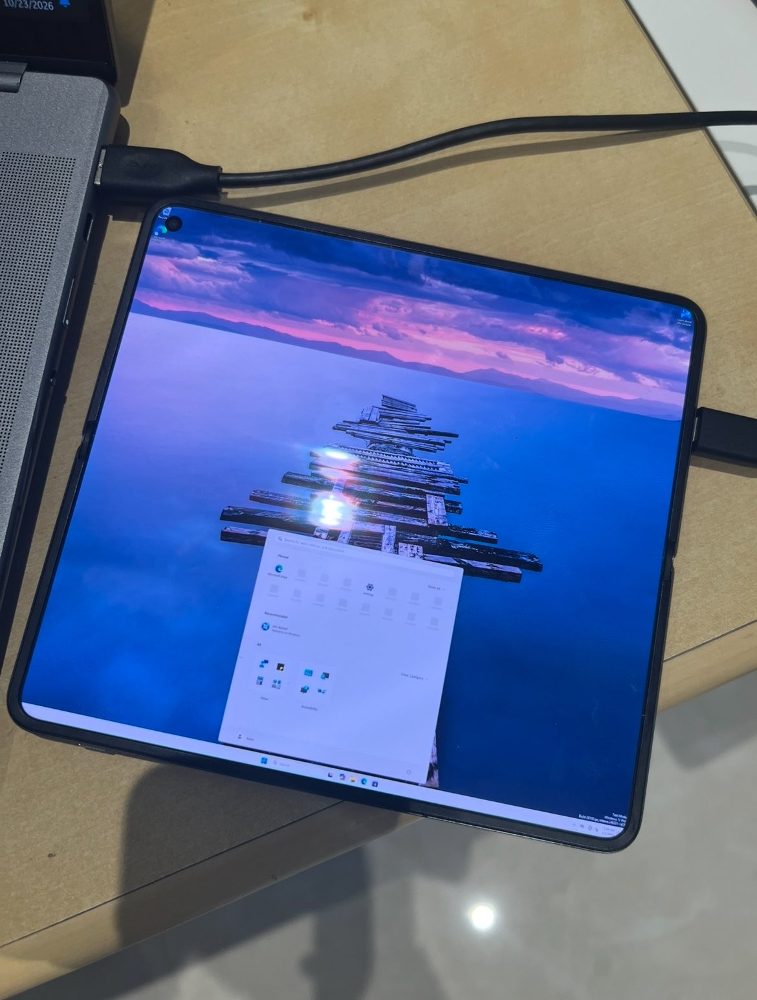

# Windows 11 ARM64 on OnePlus Open

Native Windows on the **OnePlus Open**, built around Qualcomm **Snapdragon 8 Gen 2 / SM8550** and **Adreno 740**. Full Windows 11 and WinPE have booted on the phone, with the inner display, internal storage and native touch demonstrated. Bringing up this foldable required device-specific UEFI/ACPI, interrupt, DMA/MMU, power and driver integration.

The project reuses Windows ARM64 CPU/storage/USB stacks and OEM firmware, develops custom input and platform glue, and adapts credited Linux, UniXNU/NativeAdreno, Project Mu/Project-Aloha and Mesa/Topaz work—see [credits](docs/CREDITS.md).

> [!IMPORTANT]
> **Research source snapshot. GPU acceleration and reliable Wi-Fi networking are unfinished.** Development is paused. Captured firmware, Windows binaries, signing certificates, credentials and private operator infrastructure are excluded; this repository does not provide a ready-to-flash installation bundle.

**Demonstrated:** Windows desktop • inner framebuffer • native touchscreen • internal-storage boot • USB debugging/control • black cover framebuffer.  
**Still unfinished:** WDDM acceleration • Wi-Fi networking • Bluetooth/audio/cameras • everyday battery/charging • complete buttons, folding and suspend/resume.

## Status

| Area | Status | Notes |
|---|---|---|
| UEFI / ACPI | **WORKS ✅** | Boots WinPE and full Windows 11. |
| CPU | **WORKS ✅** | Native ARM64 execution; all eight logical processors available. |
| RAM | **WORKS ✅** | Working Windows memory and native allocations. |
| UFS / installation | **WORKS ✅** | Windows installed on and booting from internal storage. |
| Inner display | **WORKS ✅** | Usable Windows desktop with scaling; currently framebuffer rendering. |
| Touch | **WORKS ✅** | Native touchscreen input; sustained everyday use demonstrated. |
| USB debugging / control | **WORKS ✅** | Kernel debugging and remote control over USB. |
| Cover display / folding | **PARTIAL 🟡** | Cover image can be cleared to black; panel switching and folding remain unfinished. |
| Physical buttons | **IN PROGRESS 🛠️** | Hardware reader implemented; power-button behavior awaits a physical test. |
| GPU / WDDM acceleration | **IN PROGRESS 🛠️** | GMU firmware and HFI working; first GPU command completion is the current blocker. |
| Wi-Fi | **IN PROGRESS 🛠️** | Firmware loads and initial exchanges work; response/credit stalls block usable networking. |
| USB peripherals | **NOT WORKING ❌** | External keyboard / host-mode support remains unfinished. |
| Crash recovery | **PARTIAL 🟡** | Recovery tools work; automatic reconnection is not reliable after every crash. |
| Battery reporting | **IN PROGRESS 🛠️** | Raw sensor readings acquired; Windows battery reporting remains unfinished. |
| Charging | **IN PROGRESS 🛠️** | Charging current measured in bounded WinPE tests; normal Windows charging remains unfinished. |
| Power management | **PARTIAL 🟡** | Usable while awake; suspend/resume and power-saving integration remain unfinished. |
| Audio | **NOT WORKING ❌** | Speakers and microphone remain unfinished. |
| Bluetooth | **NOT WORKING ❌** | Windows radio integration remains unfinished. |
| Motion / light / proximity sensors | **NOT WORKING ❌** | Windows sensor integration remains unfinished. |
| Cameras | **NOT WORKING ❌** | Sensor/ISP and Windows camera integration remain unfinished. |
| Cellular | **NOT WORKING ❌** | Modem/SIM and mobile-network integration remain unfinished. |
| GNSS | **NOT WORKING ❌** | Windows location integration remains unfinished. |
| NFC | **NOT WORKING ❌** | Windows NFC integration remains unfinished. |
| TPM / production boot security | **NOT WORKING ❌** | Windows TPM and production Secure Boot integration remain unfinished. |

<strong>Detailed development checkpoints</strong>

These [subfeature checklists](docs/STATUS.md) track implementation and future refinements alongside the usable features above.

## UEFI / ACPI — 4/6 complete

- [x] OEM boot-chain integration.
- [x] Custom DXE/ACPI resources.
- [x] Windows boot-manager handoff.
- [x] WinPE and full Windows boots.
- [ ] Portable public build/reconstruction workflow.
- [ ] Cold-start and recovery hardening.

## CPU — 2/4 complete

- [x] Windows ARM64 execution.
- [x] Eight logical processors enumerated.
- [ ] Platform DVFS/performance qualification.
- [ ] Idle and thermal-policy qualification.

## RAM — 2/4 complete

- [x] Usable Windows memory map.
- [x] Native allocations used by the working system.
- [ ] Full-capacity/stress qualification.
- [ ] Memory retention across suspend.

## UFS / installation — 3/5 complete

- [x] 4 KiB-sector filesystem integration.
- [x] Windows-compatible partition typing.
- [x] Installed Windows boots from internal storage.
- [ ] Reproducible installation/servicing workflow.
- [ ] Power-loss and storage-performance qualification.

## Inner display — 2/5 complete

- [x] Windows framebuffer desktop.
- [x] Usable desktop scaling.
- [ ] Accelerated presentation.
- [ ] Brightness management.
- [ ] Display sleep/wake lifecycle.

## Cover display / folding — 1/4 complete

- [x] Cover framebuffer cleared and verified black.
- [ ] Electrical panel-off.
- [ ] Fold-driven panel switching.
- [ ] Cover touch/display integration.

## Touch — 3/5 complete

- [x] Controller transport and report decoding.
- [x] Native HID/VHF input.
- [x] Sustained touch demonstrated by physical use.
- [ ] Complete fold/panel/stylus/palm coverage.
- [ ] General suspend/resume qualification.

## Physical buttons — 1/3 complete

- [x] Integrated cached hardware reader.
- [ ] Physical power-button display-off test.
- [ ] Physical second-press wake test.

## GPU / WDDM — 3/8 complete

- [x] Kernel resource/ownership foundations.
- [x] GMU firmware and HFI acknowledgements.
- [x] CPU-verified GPU buffer/table preparation.
- [ ] First CP command/fence completion.
- [ ] Repeatable submission, interrupts and completion.
- [ ] A740 WDDM memory/scheduling/DDI integration.
- [ ] Hardware-backed userspace graphics integration.
- [ ] Application rendering and desktop presentation.

## Wi-Fi — 3/6 complete

- [x] PCIe enumeration and register access.
- [x] Firmware load and initial exchanges.
- [x] Original Windows driver/interface initialization.
- [ ] Sustained firmware responses/credits.
- [ ] Stable scan, authentication and association.
- [ ] DHCP, DNS and real network traffic.

## USB — 3/6 complete

- [x] USB device/debug enumeration.
- [x] Kernel-debug and control data transport.
- [x] Read-only USB storage recovery demonstrated.
- [ ] External host keyboard/HID support.
- [ ] Reliable role switching.
- [ ] PD/power integration.

## Debugging / recovery — 4/6 complete

- [x] Kernel debugging.
- [x] Authenticated remote-control workflow.
- [x] Guarded one-shot boot/recovery workflow.
- [x] Sahara emergency reset demonstrated.
- [ ] Reliable reconnection after every crash.
- [ ] Actionable capture of the current GPU fatal boundary.

## Battery reporting — 1/4 complete

- [x] Raw physical sensor acquisition demonstrated.
- [ ] Installed Windows battery-class frontend.
- [ ] Validated pack/percentage/rate semantics.
- [ ] Sustained normal-Windows lifecycle.

## Charging — 1/4 complete

- [x] Bounded WinPE tests measured charging current.
- [ ] Sustained normal-Windows charging.
- [ ] Reliable USB-C/source negotiation.
- [ ] Complete safety/thermal/full-charge policy.

## Power management — 1/5 complete

- [x] Working awake profile for development.
- [ ] System suspend/resume.
- [ ] Display/power-button lifecycle.
- [ ] Idle clock and rail policies.
- [ ] Thermal/performance policies.

## Audio — 0/3 complete

- [ ] Windows audio-device integration.
- [ ] Speaker playback.
- [ ] Microphone capture.

## Bluetooth — 0/3 complete

- [ ] Windows radio integration.
- [ ] Pairing.
- [ ] Actual peripheral traffic.

## Motion / light / proximity sensors — 0/3 complete

- [ ] Windows sensor integration.
- [ ] Validated readings.
- [ ] Orientation/automatic-policy integration.

## Cameras — 0/3 complete

- [ ] Sensor/ISP initialization.
- [ ] Windows camera integration.
- [ ] Validated capture.

## Cellular — 0/3 complete

- [ ] Modem/SIM service integration.
- [ ] Network registration.
- [ ] Usable data/call paths.

## GNSS — 0/2 complete

- [ ] Windows location integration.
- [ ] Validated positioning.

## NFC — 0/2 complete

- [ ] Windows NFC integration.
- [ ] Functional transactions.

## TPM / production boot security — 0/3 complete

- [ ] Working Windows TPM integration.
- [ ] Production Secure Boot configuration.
- [ ] Security qualification without development test-signing.

## See it in action

Windows 11 running natively on the OnePlus Open.

https://github.com/user-attachments/assets/2b834bc3-bc92-4345-a5e6-32ab159f1ff7

## The next useful work

- **Adreno 740:** obtain the first native command-processor completion. GMU/HFI and the secure-aperture call work; the latest attempt still failed at the first SQE-start store boundary. WDDM and userspace integration remain downstream of this blocker.
- **Wi-Fi:** resolve the firmware response/credit stall before another association attempt. A thread/scheduler metadata correspondence is a lead, not an established crash diagnosis.
- **Reproducibility:** turn the source closures and upstream pins into portable local builds using independently obtained platform inputs.

See the [agent handoff](docs/AGENT_HANDOFF.md) for the latest experiment, failed hypotheses, precise next discriminators and preservation rules. The [source map](docs/SOURCE_MAP.md) separates current components from historical experiments. Read [build and publication boundaries](docs/BUILDING.md) before using any tooling.

## Contributing

Useful contributions include SM8550/Adreno 740 driver expertise, WCN7850 firmware/transport analysis, reproducible builds and clearly bounded native evidence. Report what actually executed and what was inferred; distinguish compiled prototypes from working Windows hardware. Read [licensing](LICENSING.md) before copying or redistributing code. Please do not include private logs, device identities, network profiles, keys or proprietary binaries in issues or pull requests.

This is a source-available Windows-on-ARM research project. File-specific upstream notices remain applicable; no new repository-wide license is granted for original files without their own license notices.
