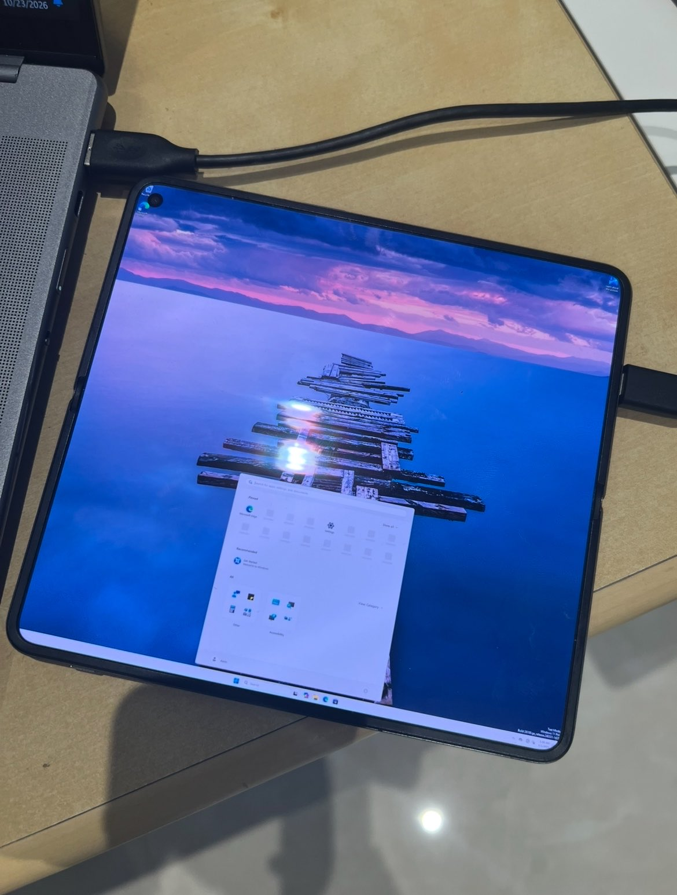

# Windows 11 ARM64 on OnePlus Open

Native Windows on the **OnePlus Open**, built around Qualcomm **Snapdragon 8 Gen 2 / SM8550** and **Adreno 740**. Full Windows 11 and WinPE have booted on the phone, with the inner display, internal storage and native touch demonstrated. Bringing up this foldable required device-specific UEFI/ACPI, interrupt, DMA/MMU, power and driver integration.

The project reuses Windows ARM64 CPU/storage/USB stacks and OEM firmware, develops custom input and platform glue, and adapts credited Linux, UniXNU/NativeAdreno, Project Mu/Project-Aloha and Mesa/Topaz work—see [credits](docs/CREDITS.md).

> [!IMPORTANT]
> **Research source snapshot.** Development is active. Captured firmware, Windows binaries, signing certificates, credentials and private operator infrastructure are excluded; this repository does not provide a ready-to-flash installation bundle.

**Demonstrated:** Windows 11 default boot • inner framebuffer • native touchscreen • internal-storage boot • **Wi-Fi (WCN7850 802.11ax, WPA2/DHCP/DNS/HTTPS)** • **Adreno 740 WDDM 1.3 + Mesa Turnip (Vulkan 1.3) + Mesa Zink (OpenGL 4.6) + DXVK 3.1.1 (DirectX 11)** • USB debugging/control • black cover framebuffer.  
**Still unfinished:** Accelerated DWM desktop presentation • Bluetooth/audio/cameras • everyday battery/charging • complete buttons, folding and suspend/resume.

## Status

| Area | Status | Notes |
|---|---|---|
| UEFI / ACPI | **WORKS ✅** | Boots full Windows 11 (default) and WinPE. |
| CPU | **WORKS ✅** | Native ARM64 execution; all eight logical processors available. |
| RAM | **WORKS ✅** | Working Windows memory and native allocations. |
| UFS / installation | **WORKS ✅** | Windows installed on and booting from internal storage. |
| Inner display | **WORKS ✅** | Usable Windows desktop with scaling; currently framebuffer presentation. |
| Touch | **WORKS ✅** | Native touchscreen input; sustained everyday use demonstrated. |
| Wi-Fi | **WORKS ✅** | WCN7850 802.11ax WPA2/DHCP/DNS/HTTPS sustained live via [`OpenWcnSleepClk`](drivers/wlan/OpenWcnSleepClk/) (enabling PMK8550 GPIO3 32.768 kHz `sleep_clk`) + stock `qcwlanhmt8380.sys`. |
| GPU / WDDM acceleration | **WORKS ✅** | Adreno 740 WDDM 1.3 bridge (`topazgpu_v12.sys`) + [Mesa Turnip Vulkan 1.3 + Mesa Zink OpenGL 4.6 + DXVK 3.1.1 D3D11](drivers/gpu/turnip-wddm/) live-verified on hardware; DWM desktop presentation remains framebuffer. |
| USB debugging / control | **WORKS ✅** | Kernel debugging and remote control over USB. |
| Cover display / folding | **PARTIAL 🟡** | Cover image can be cleared to black; panel switching and folding remain unfinished. |
| Physical buttons | **IN PROGRESS 🛠️** | Hardware reader implemented; power-button behavior awaits a physical test. |
| USB peripherals | **NOT WORKING ❌** | External keyboard / host-mode support remains unfinished. |
| Crash recovery | **PARTIAL 🟡** | Recovery tools work; automatic reconnection is not reliable after every crash. |
| Battery reporting | **IN PROGRESS 🛠️** | Raw sensor readings acquired; Windows battery reporting remains unfinished. |
| Charging | **IN PROGRESS 🛠️** | Charging current measured in bounded WinPE tests; normal Windows charging remains unfinished. |
| Power management | **PARTIAL 🟡** | Usable while awake; suspend/resume and power-saving integration remain unfinished. |
| Audio | **NOT WORKING ❌** | Speakers and microphone remain unfinished. |
| Bluetooth | **NOT WORKING ❌** | Windows radio integration remains unfinished. |
| Motion / light / proximity sensors | **NOT WORKING ❌** | Windows sensor integration remains unfinished. |
| Cameras | **NOT WORKING ❌** | Sensor/ISP and Windows camera integration remain unfinished. |
| Cellular | **NOT WORKING ❌** | Modem/SIM and mobile-network integration remain unfinished. |
| GNSS | **NOT WORKING ❌** | Windows location integration remains unfinished. |
| NFC | **NOT WORKING ❌** | Windows NFC integration remains unfinished. |
| TPM / production boot security | **NOT WORKING ❌** | Windows TPM and production Secure Boot integration remain unfinished. |

<strong>Detailed development checkpoints</strong>

These [subfeature checklists](docs/STATUS.md) track implementation and future refinements alongside the usable features above.

## UEFI / ACPI — 4/6 complete

- [x] OEM boot-chain integration.
- [x] Custom DXE/ACPI resources.
- [x] Windows boot-manager handoff.
- [x] WinPE and full Windows boots.
- [ ] Portable public build/reconstruction workflow.
- [ ] Cold-start and recovery hardening.

## CPU — 2/4 complete

- [x] Windows ARM64 execution.
- [x] Eight logical processors enumerated.
- [ ] Platform DVFS/performance qualification.
- [ ] Idle and thermal-policy qualification.

## RAM — 2/4 complete

- [x] Usable Windows memory map.
- [x] Native allocations used by the working system.
- [ ] Full-capacity/stress qualification.
- [ ] Memory retention across suspend.

## UFS / installation — 3/5 complete

- [x] 4 KiB-sector filesystem integration.
- [x] Windows-compatible partition typing.
- [x] Installed Windows boots from internal storage.
- [ ] Reproducible installation/servicing workflow.
- [ ] Power-loss and storage-performance qualification.

## Inner display — 2/5 complete

- [x] Windows framebuffer desktop.
- [x] Usable desktop scaling.
- [ ] Accelerated presentation.
- [ ] Brightness management.
- [ ] Display sleep/wake lifecycle.

## Cover display / folding — 1/4 complete

- [x] Cover framebuffer cleared and verified black.
- [ ] Electrical panel-off.
- [ ] Fold-driven panel switching.
- [ ] Cover touch/display integration.

## Touch — 3/5 complete

- [x] Controller transport and report decoding.
- [x] Native HID/VHF input.
- [x] Sustained touch demonstrated by physical use.
- [ ] Complete fold/panel/stylus/palm coverage.
- [ ] General suspend/resume qualification.

## Physical buttons — 1/3 complete

- [x] Integrated cached hardware reader.
- [ ] Physical power-button display-off test.
- [ ] Physical second-press wake test.

## GPU / WDDM — 8/9 complete

- [x] Kernel resource/ownership foundations.
- [x] GMU firmware and HFI acknowledgements.
- [x] CPU-verified GPU buffer/table preparation.
- [x] Hardware translation to the expected SQE firmware page, with controls restored.
- [x] First CP command/fence completion.
- [x] Repeatable submission, interrupts and completion.
- [x] A740 WDDM memory/scheduling/DDI integration (`topazgpu_v12.sys`).
- [x] Hardware-backed userspace graphics integration (Mesa Turnip Vulkan 1.3 + Mesa Zink OpenGL 4.6 + DXVK 3.1.1 D3D11).
- [ ] Accelerated DWM desktop presentation.

## Wi-Fi — 6/6 complete

- [x] PCIe enumeration and register access.
- [x] Firmware load and initial exchanges.
- [x] Original Windows driver/interface initialization.
- [x] Sustained firmware responses/credits (PMK8550 GPIO3 32.768 kHz `sleep_clk` via `OpenWcnSleepClk.sys`).
- [x] Stable scan, authentication and association (`802.11ax` WPA2-Personal CCMP).
- [x] DHCP, DNS and real network traffic (sustained ping and HTTPS).

## USB — 3/6 complete

- [x] USB device/debug enumeration.
- [x] Kernel-debug and control data transport.
- [x] Read-only USB storage recovery demonstrated.
- [ ] External host keyboard/HID support.
- [ ] Reliable role switching.
- [ ] PD/power integration.

## Debugging / recovery — 4/6 complete

- [x] Kernel debugging.
- [x] Authenticated remote-control workflow.
- [x] Guarded one-shot boot/recovery workflow.
- [x] Sahara emergency reset demonstrated.
- [ ] Reliable reconnection after every crash.
- [ ] Actionable capture of the current GPU fatal boundary.

## Battery reporting — 1/4 complete

- [x] Raw physical sensor acquisition demonstrated.
- [ ] Installed Windows battery-class frontend.
- [ ] Validated pack/percentage/rate semantics.
- [ ] Sustained normal-Windows lifecycle.

## Charging — 1/4 complete

- [x] Bounded WinPE tests measured charging current.
- [ ] Sustained normal-Windows charging.
- [ ] Reliable USB-C/source negotiation.
- [ ] Complete safety/thermal/full-charge policy.

## Power management — 1/5 complete

- [x] Working awake profile for development.
- [ ] System suspend/resume.
- [ ] Display/power-button lifecycle.
- [ ] Idle clock and rail policies.
- [ ] Thermal/performance policies.

## Audio — 0/3 complete

- [ ] Windows audio-device integration.
- [ ] Speaker playback.
- [ ] Microphone capture.

## Bluetooth — 0/3 complete

- [ ] Windows radio integration.
- [ ] Pairing.
- [ ] Actual peripheral traffic.

## Motion / light / proximity sensors — 0/3 complete

- [ ] Windows sensor integration.
- [ ] Validated readings.
- [ ] Orientation/automatic-policy integration.

## Cameras — 0/3 complete

- [ ] Sensor/ISP initialization.
- [ ] Windows camera integration.
- [ ] Validated capture.

## Cellular — 0/3 complete

- [ ] Modem/SIM service integration.
- [ ] Network registration.
- [ ] Usable data/call paths.

## GNSS — 0/2 complete

- [ ] Windows location integration.
- [ ] Validated positioning.

## NFC — 0/2 complete

- [ ] Windows NFC integration.
- [ ] Functional transactions.

## TPM / production boot security — 0/3 complete

- [ ] Working Windows TPM integration.
- [ ] Production Secure Boot configuration.
- [ ] Security qualification without development test-signing.

## See it in action

Windows 11 running natively on the OnePlus Open.

https://github.com/user-attachments/assets/2b834bc3-bc92-4345-a5e6-32ab159f1ff7

## Permanent driver & graphics stack

- **Wi-Fi (WCN7850):** [`drivers/wlan/OpenWcnSleepClk/`](drivers/wlan/OpenWcnSleepClk/) installs as a `SYSTEM_START` kernel driver (`Group = "System Bus Extender"`) that configures PMK8550 GPIO3 (`SID=0, PPID=0xBA`) as `func1` 32.768 kHz `sleep_clk` output before `NDIS` starts stock `qcwlanhmt8380.sys`.
- **Adreno 740 Kernel Bridge (Option 1 — Desktop-Safe Coexistence):** `OpenSmmuD0` (GPU SMMU bootstrap) + `OpenGpuStart` ([`topazgpu_wdm.c`](drivers/gpu/turnip-wddm/topazgpu_wdm.c)) start automatically on Windows 11 boot and expose `\\.\TopazGpu` (`IOCTL_TOPAZ_ESCAPE = 0x222000`) without registering a competing WDDM display adapter, keeping `Microsoft Basic Display Driver` (`BasicDisplay`) and `dwm.exe` 100% undisturbed.
- **Userspace Graphics Stack (Option A):** [`drivers/gpu/turnip-wddm/`](drivers/gpu/turnip-wddm/) provides:
  - **Vulkan 1.3 (Mesa Turnip):** Registered globally in `HKLM\SOFTWARE\Khronos\Vulkan\Drivers` (`freedreno_icd.aarch64.json` -> `vulkan_freedreno.dll`) so all Vulkan apps use `Turnip Adreno (TM) 740` automatically via `C:\Windows\System32\vulkan-1.dll` (prefers `\\.\TopazGpu` with fallback to `D3DKMT`).
  - **OpenGL 4.6 (Mesa Zink)** & **DirectX 8/9/10/11 (DXVK 3.1.1):** Staged in `C:\Program Files\Adreno740-Graphics\{zink,dxvk}\` for per-application drop-in next to target executables (leaving inbox `System32\d3d11.dll` and `dxgi.dll` untouched for DWM stability).

## The next useful work

- **TODO (Option 2 — Full DWM / System UI GPU Acceleration):** Wire VidPN framebuffer presentation in `topazgpu` alongside a native Windows D3D11 User-Mode Driver (`UserModeDriverName`, e.g., Mesa `d3d10umd` + Gallium `freedreno` `FD740` or Zink/Turnip) so Windows DWM, Explorer, UWP/WinUI apps, and browsers also render directly on Adreno 740 instead of `BasicDisplay` + WARP.
- **Post-GPU Roadmap (unordered):**
  - **Sound:** Speakers, microphone, and Windows audio endpoint integration.
  - **Bluetooth:** WCN7850 Bluetooth radio bring-up, pairing, and peripheral traffic.
  - **Sleep (Modern Standby / S0ix):** SM8550 supports Low-Power S0 Idle (PSCI + RPMh/RSC); requires ACPI `_LPI`/PEP, display & touch sleep/wake recovery (including fixing touch becoming unresponsive after power-button screen on/off cycles), and clean `D0`/`D3` driver transitions.
  - **Power management:** CPU DVFS, idle clock/rail policies, and thermal management.
  - **USB accessories support:** USB host mode (DRD/URS role switching) for external keyboards, hubs, and peripherals.
  - **Proper battery charging and indicator:** Sustained normal-Windows USB-C/PD charging and Windows battery-class indicator (`percentage`, `rate`, `charging state`).
  - **Cameras:** Camera sensor/ISP bring-up and Windows camera integration.
  - **Accelerometer and other useful sensors:** Motion, orientation, ambient light, proximity, and hinge/fold sensors.
  - **Brightness control:** Inner OLED panel brightness via DSI DCS commands and Windows brightness-slider integration (`GUID_DEVINTERFACE_BRIGHTNESS`).
- **Reproducibility:** Turn the source closures and upstream pins into portable local builds using independently obtained platform inputs.

See the [agent handoff](docs/AGENT_HANDOFF.md) for the latest experiment, failed hypotheses, precise next discriminators and preservation rules. The [source map](docs/SOURCE_MAP.md) separates current components from historical experiments. Read [build and publication boundaries](docs/BUILDING.md) before using any tooling.

## Contributing

Useful contributions include SM8550/Adreno 740 driver expertise, WCN7850 firmware/transport analysis, reproducible builds and clearly bounded native evidence. Report what actually executed and what was inferred; distinguish compiled prototypes from working Windows hardware. Read [licensing](LICENSING.md) before copying or redistributing code. Please do not include private logs, device identities, network profiles, keys or proprietary binaries in issues or pull requests.

This is a source-available Windows-on-ARM research project. File-specific upstream notices remain applicable; no new repository-wide license is granted for original files without their own license notices.
