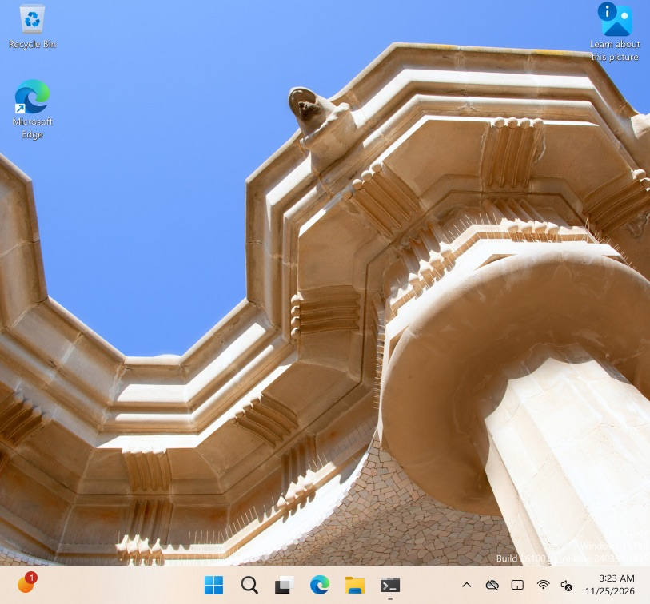
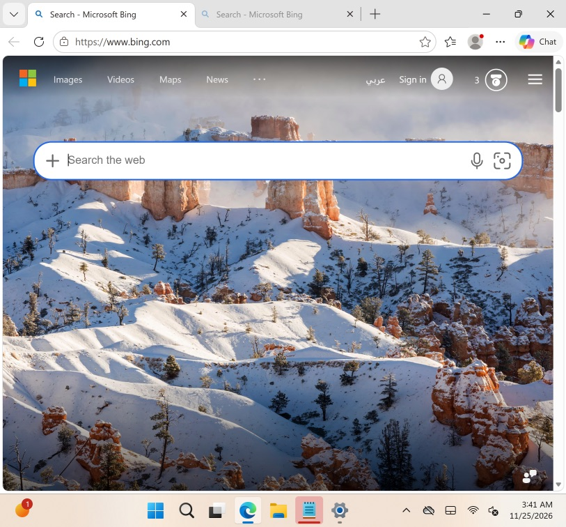

# Option 2 — Adreno 740 display + native D3D11 UMD (accelerated DWM path)

Goal: let Windows itself (DWM, Explorer, inbox `d3d11.dll`/`dxgi.dll` apps) render on the Adreno 740
instead of `BasicDisplay` + WARP.

| Step | Component | Status |
|---|---|---|
| 2A | `topazgpu_opt2.sys` WDDM 1.3 Display+Render KMD driving the inner panel via the UEFI GOP framebuffer (VidPN source/target, 60 Hz timer VSync, scanout copy) | **Works** — `AcquirePostDisplayOwnership 2440x2268 pitch 9760 pa b8000000`, `CommitVidPn`, `SetVidPnSourceAddress`, scanout; `dwm.exe`/`explorer.exe` stable |
| 2B | `ogpu_d3d10.dll` — Mesa 24.3 `d3d10umd` frontend + Gallium `freedreno` (FD740) over the Topaz `msm` escape, registered as `UserModeDriverName` | **Works** — DWM, Explorer, Start/Search, TextInputHost, Settings, Notepad, ApplicationFrameHost and Edge load `ogpu_d3d10.dll`; permanent at boot |



## Key fix: leave GPU secure mode (ZAP shader)

2D/3D IBs completed their fences but wrote nothing (raw `CP_MEM_WRITE` worked). `RBBM_SECVID_TRUST_CNTL`
was still `1`: the GPU stayed in trusted mode because the A740 ZAP shader was never authenticated. The bridge
now loads `a740_zap.mdt/.b01` (PAS 13, `PIL_INIT_IMAGE` → `PIL_MEM_SETUP(0x9b09a000, 0x2000)` →
`PIL_AUTH_RESET` via SCM, `a740_smc.S`) and submits `CP_SET_SECURE_MODE(0)`:

```
A740ExitSecureMode: RBBM_SECVID_TRUST_CNTL before=00000001
A740ZapLoad: PIL_INIT_IMAGE st=0 res=0
A740ZapLoad: PIL_MEM_SETUP(0x9b09a000, 0x2000) st=0 res=0
A740ZapLoad: PIL_AUTH_RESET st=0 res=0
A740ExitSecureMode: CP_SET_SECURE_MODE(0) fence=2 done=2 RBBM_SECVID_TRUST_CNTL after=00000000
```

The ZAP firmware is OEM-owned and is **not** in this repository; the driver reads it from `C:\topaz\fw\`.

## Live result (2026-11-25, OnePlus Open, Windows 11 26300 ARM64)

```
test_turnip_a740:  vkCmdFillBuffer READBACK ptr[0]=0xdeadbeef ptr[1023]=0xdeadbeef   TURNIP_RC=0
test_inbox_d3d11 (System32 dxgi.dll + d3d11.dll -> ogpu_d3d10.dll):
  Adapter[0]: Open A740 ... ; D3D11CreateDevice(HW) hr=0 fl=0xa000
  BLIT_PIXEL[0,0] = 0xdeadbeef   PIXEL[0,0] = 0xffcc8033 (ClearRenderTargetView)   PASS
DIAG submit#1..3: rbbm=00000001 hwf=0 cpint=0 prot=0 fsr=00000400 (no faults)
```

## DWM bring-up fixes (2026-11-25)

With the KMD as primary display but no usable UMD, DWM crash-looped (`0x889800b0` in `dwmcore.dll`).
Enabling the UMD for DWM exposed the remaining blockers, all in GPU memory management:

1. **Low-memory exhaustion.** All BOs and SMMU page tables were allocated below 4 GiB, where SM8550 has
   only ~2 GiB of mostly reserved RAM, so DWM's 2440×2268 (24 MiB) surfaces failed. The bridge now reads
   CB0 `TCR2.PASize` live (`TCR2=0x00038071` → 42-bit, VA64) and allocates BOs ≥ 2 MiB and fallback
   page tables anywhere below 64 GiB.
2. **GPU VA leak.** `VaFree` was a no-op; every DWM restart leaked address space. Added a coalescing
   free list.
3. **Submit limits.** `HwSubmit` rejected > 64 IBs (DWM submits 66+) and never checked ring space. Now up
   to 512 IBs with a wait on `CP_RB_RPTR` before overwriting unfetched ring dwords.
4. **Mesa `d3d10umd` bug.** `CreateResource` tested `if (!pResource)` instead of
   `if (!pResource->resource)`, turning an allocation failure into an access violation inside DWM.

## Permanent installation and verification (2026-11-25)

`install/init_adreno740.ps1` runs as the SYSTEM startup task `OnePlus-Open-Adreno740-Init`:

1. forces `OpenSmmuD0`/`OpenGpuStart` back to `Start=4` (PnP never starts the GPU on its own);
2. skips the GPU and keeps Microsoft Basic Display if `C:\topaz\gpu.disable` exists, or converts a leftover
   `gpu.boot.pending` (a previous start that never finished) into `gpu.disable`;
3. re-enumerates the clock parent (`ACPI\OPEN0182\1`) and starts `OpenSmmuD0` + `topazgpu_opt2.sys`;
4. watches DWM for 45 s — three or more DWM exits write `gpu.disable` and reboot to the safe desktop.

Hands-off cold reboot (no manual steps):

```
boot.log: OPEN0515 status OK; OpenGpuStart Running / GPU start OK (DWM exits 0)
services: OpenWcnSleepClk, qcwlan, OpenSmmuD0, OpenGpuStart, OpenChargerKeeper = Running
ogpu_d3d10.dll loaded by: dwm, explorer, SearchHost, StartMenuExperienceHost, TextInputHost
Wi-Fi: VIRUS-1 connected (802.11ax, 6 GHz)
regression on the same boot:
  Turnip Vulkan 1.3 vkCmdFillBuffer readback 0xdeadbeef            PASS
  inbox D3D11 (ogpu_d3d10) blit 0xdeadbeef / clear 0xffcc8033       PASS
  Zink GL 4.6 "zink Vulkan 1.3(Turnip Adreno (TM) 740)"             PASS
  DXVK 3.1.1 D3D11CreateDevice FL 11_0 on Turnip                    PASS
KMD heartbeat: ~60 vsync notifications/s, flips completing, no SMMU/CP faults, no ring stalls
```



Known limits: scanout is a CPU copy of the primary into the UEFI GOP framebuffer (no MDP programming yet),
no D3D12 UMD, GPU completion is polled (interrupts masked), no TDR/GPU reset, no GPU power management.
The KMD writes a heartbeat (`HB`/`DISP` lines) to `C:\TopazGpuW.log` every 3 s for 3 min, then every 30 s.

## Contents

- `kmd/` — Option 2 sources that differ from `drivers/gpu/gpu-wddm-bridge-G779` / G1352:
  `ddi.c`, `disp.c` (GOP VidPN display path adapted from Topaz `TopazGpuW/disp.c`), `a740_wddm_bridge.c`
  (A740 bring-up bridge + ZAP/secure-mode exit), `a740_smc.S`, `topazgpu_escape.h`.
  The remaining objects are the G1350/SID0+SID1 owner closure (`experiments/G1351…`, `G1352`).
- `mesa/` — full working-tree diff against Mesa `62f1e49` (24.3-devel) used for `vulkan_freedreno.dll`,
  Zink and `ogpu_d3d10.dll`, plus the new `fd_wddm.c` (freedreno DRM backend over the escape) and
  `topaz_wddm.cpp` (d3d10umd ↔ KMD glue).
- `install/` — `init_adreno740.ps1` boot task script.
- `tests/` — `test_inbox_d3d11.c` (inbox runtime blit + clear readback), `test_dxvk_pixel.c`.

## UMD opt-in gate

`ogpu_d3d10.dll` only claims the adapter when `TOPAZGPU_ENABLE` is set (per process) or
`C:\topaz\umd.enable` exists (global); `C:\topaz\umd.dwmonly` restricts it to `dwm.exe`. Without the gate,
the D3D runtime falls back to WARP, keeping the desktop recoverable.
